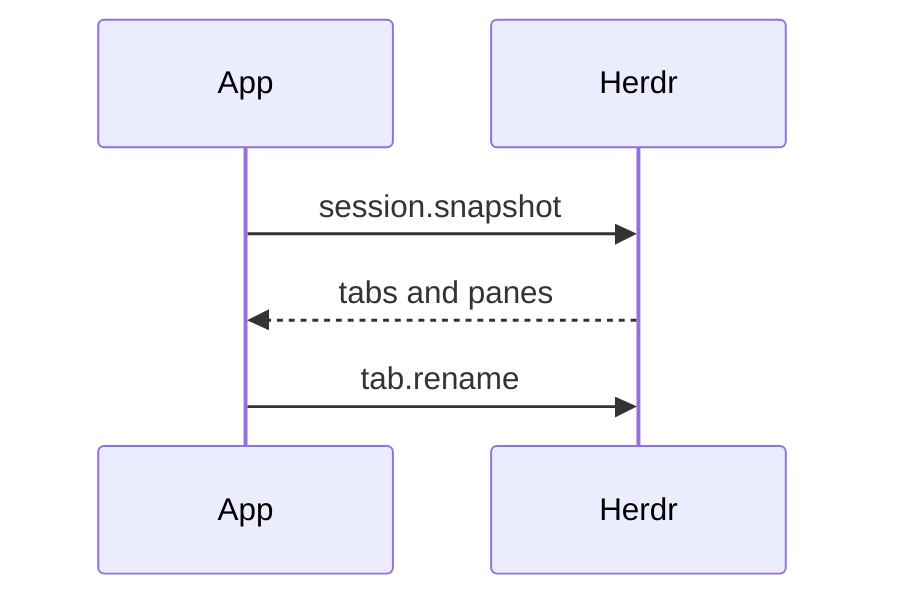

# PR

Every pull request body here follows
[.github/pull_request_template.md](../../../.github/pull_request_template.md).
Read it, fill each section as below, and delete its HTML comments. Keep the
`Before merging` checklist, ticking only what is true.

Skip preambles and keep prose brief. Use the words the code and
[docs/architecture](../../../docs/architecture/) use: pane, tab, label, poll,
snapshot, source, claim. Write in English, whatever language the request came in.
Add no "Generated with" line or other attribution, for the same reason
[AGENTS.md](../../../AGENTS.md) forbids a co-author trailer in a commit.

## Summary

Pick the smallest view that makes the key point clear, and put a line of why
beside it. Link the issue with `Closes #N`, or `Related: #N` when the issue
stays open after this pull request.

- Logic or an algorithm as pseudocode:

```text
on(poll)
  if the pane's revision did not move and the read is fresh
    reuse the process read
  read pane.process_info
```

- Runtime control flow as a call tree:

```text
App.poll
  App.readAndRename
    Labels.Pass
    App.tabsIn
    App.nameTab
      Pass.Tab
    App.namePanes
```

- File responsibility or a broad refactor as a shallow file tree:

```text
internal/
├── state/      # a snapshot turned into what each tab is doing
├── resolver/   # that state turned into a title
└── labels/     # that title put on, unless the label is the user's own
```

- Component interaction or data flow with Mermaid:



- A `diff` when the point is what changes and the surrounding shape already
  exists. Match the diff shape to the topic:

```diff
 App.readAndRename
   Labels.Pass
   App.tabsIn
   App.nameTab
     Pass.Tab
-  App.namePanes
+  if panes are named
+    App.namePanes
+  App.reportTopics
```

- The whole block when most of it is new, when omitted context would hide
  ownership or order, or when the reader needs a copyable target shape.

Place each visual next to the short text it supports. Keep only the calls,
files, fields, states and boundaries needed to make the point. One view is
usually enough, several are sometimes needed, all of them never are.

## Evidence

Concrete evidence the change works: a before and an after.

- A tab bar from a live Herdr session is S-tier when the change is visible
  there; describe it in text when a screenshot is not to hand.
- Execution-based evidence is A-tier: the exact test that failed and now
  passes, named, with its output; a `make probe-*` or `scripts/probe.py` run.
- `make check` green is the floor, not evidence. Say it only in the checklist.

## Merge Danger

**Door:** `one-way` or `two-way`. A two-way door is cheap to walk back. Here
the usual one-way doors are a label written onto the user's tabs or panes that
a revert cannot take back, a token reported to a workspace, a setting in
`config.env` whose meaning changes, and a rename that freezes a workspace's
label for good.

**Blast Radius:** one word, then a line of what could break and for whom:
the user's own tab names, Windows or Linux only, a Herdr version, the restart
handoff, a poll's cost.
